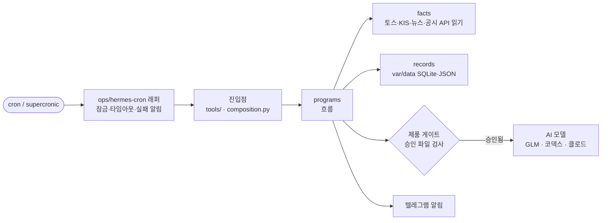

# tokmo-v3

tokmo-v3는 토스증권 계좌의 보유 종목과 체결 내역을 모으고, 관련 뉴스와 공시를 골라 텔레그램으로 알려 주는 개인용 투자 보조 시스템입니다. 정해 둔 범위 안에서 소량 회전매매 주문을 내거나, 실주문 없이 모의투자를 운용할 수도 있습니다.

투자 판단을 대신하지 않습니다. 실주문은 설치한 사람이 플래그 파일을 직접 만들어야 나가며, AI 모델은 설치본마다 발급한 승인 파일이 있어야 호출됩니다.

## 모듈별 동작

모듈은 서로 독립적이어서 필요한 것만 켤 수 있습니다. 켜고 끄는 방법은 [설치와 모듈 설정](docs/setup.md)에 있습니다.

**펄스·캐던스 (토스 수집)**
펄스는 1분마다 토스증권 오픈API에서 보유 종목, 체결, 조건주문을 읽습니다. 텔레그램 스톡봇 대화에 남긴 매매 사유도 이때 기록합니다. 캐던스는 5분마다 시세, 거래 달력, 장 운영 정보를 갱신합니다. 토큰은 매분 0-5초 사이에만 읽습니다.

**뉴스 판단·알림**
국내외 뉴스와 OpenDART·SEC 공시를 세 그룹으로 나눠 15분마다 수집합니다. 수집한 기사는 거르기(`screen`)와 1차 분석(`first_pass`) 단계를 거치고, 필요할 때만 확정(`confirm`) 단계의 상위 모델에 넘깁니다. 중요한 뉴스는 바로 보내고, 나머지는 저녁에 모아서 보냅니다. 단계마다 어떤 모델을 쓸지와, 그 모델이 막혔을 때 넘어갈 순서는 `var/data/models.json`에서 정합니다.

**선택 후속 점검**
사용자가 스톡봇 대화로 남긴 매매 선택을 새 뉴스·시세와 비교해서, 달라진 점이 있을 때만 알립니다. 스톡봇 대화 기록이 있어야 동작합니다.

**회전매매**
승인된 가격 밴드 안에서 소량 주문을 자동으로 냅니다. 현재 대상은 현대차 한 종목입니다. 팔지 않을 보호수량과 회전에 쓰는 실험수량은 장부에서 따로 관리합니다. 평일 10:15에 분석해서 제안을 보내고, 제안은 알림을 보낸 뒤 30분 안에(늦어도 11:10) 승인해야 합니다. `var/state/hyundai-rotation/live.flag`가 없으면 주문을 보내지 않는 드라이런으로만 동작합니다.

**모의투자 (PAPER)**
실주문 없이 원장으로만 운용하는 기회 탐색형 회전입니다. 평일 10:05와 13:30에 판단하고, 판단이 끝날 때마다 결과 요약과 검토 종목을 한 번 알립니다. 매매 비용은 `ops/opportunity-rotation-costs.json`의 단순 가정을 쓰며, 실제 계좌 요율과 다릅니다.

**부가 기능**
퀀트 카드, OpenDART·SEC 공시 수집, 매크로 지표(FRED·BLS·EIA), 유튜브 자막 추적이 있습니다. 매크로와 유튜브 추적은 기본으로 꺼져 있습니다.

## 시작하기

준비물은 다음과 같습니다.

- Python 3.12, macOS 또는 Linux(WSL2 포함). Windows에서는 [Docker](docs/setup-docker.md)로 실행합니다.
- 토스증권 오픈API 자격증명
- AI 구독 1개 이상: Z.AI GLM API 키, 코덱스 CLI 로그인, 클로드 CLI 로그인 중 하나
- 텔레그램 봇

직접 설치하는 순서는 다음과 같습니다.

1. 저장소를 받고 가상환경을 만듭니다.

    ```bash
    git clone https://github.com/tae0y/tokmo-v3-docs.git ~/tokmo-v3 && cd ~/tokmo-v3
    python3.12 -m venv .venv && .venv/bin/pip install -e .
    ```

1. 자격증명 템플릿을 복사하고 값을 채웁니다. 어떤 키가 어느 파일에 들어가는지는 [자격증명 안내](docs/api-keys.md)에 정리돼 있습니다.

    ```bash
    mkdir -p var/data var/runtime var/state .secrets/hermes-credentials && chmod 700 var .secrets
    cp -R config/env.example/config .secrets/config
    cp config/env.example/env.toss.example .env.toss
    cp config/env.example/env.kis.example .env.kis
    chmod -R go-rwx .secrets .env.toss .env.kis
    ```

1. 빠진 자격증명이 없는지 확인합니다. 값은 출력되지 않습니다.

    ```bash
    .venv/bin/python tools/check_api_keys.py
    ```

1. 켤 모듈을 정하고 스케줄을 등록합니다. 처음에는 뉴스 판단만 켜는 것을 권장합니다. 절차는 [설치와 모듈 설정](docs/setup.md)을 참고하시기 바랍니다.

## 명령 모음

| 목적 | 명령 | 비고 |
|---|---|---|
| 자격증명 점검 | `.venv/bin/python tools/check_api_keys.py` | 모델 id 검증 결과도 함께 보여 줍니다 |
| AI 호출 승인 | `.venv/bin/python tools/install_product_gate.py install` → `issue` → `check` | 뉴스 판단·모의투자·퀀트를 켜기 전에 필요합니다 |
| 관심 종목 검증 | `.venv/bin/python tools/validate_watchlists.py` | `watchlists/KR.json`, `US.json` |
| 뉴스 수집 1회 | `ops/hermes-cron/tokmo_news_group.sh A` | 그룹 `A`, `B`, `C` |
| 뉴스 판단 1회 | `.venv/bin/python ops/hermes-cron/tokmo_news_classifier_worker.py` | 결과는 `var/data/news/decision-worker/latest.json` |
| 모의투자 시작 | `.venv/bin/python tools/run_opportunity_rotation.py init --costs ops/opportunity-rotation-costs.json` | 승인 파일을 먼저 발급합니다 |
| 테스트 | `.venv/bin/python -m pytest tests -q` | Linux·macOS에서만 실행됩니다 |

> **중요:** 뉴스 판단, 모의투자, 퀀트 분석은 모델을 호출하므로 구독 한도나 API 요금이 듭니다. 회전매매는 `live.flag`가 있으면 실계좌로 주문합니다.

## 하루 동안 도는 흐름

스케줄러가 `ops/hermes-cron/`의 래퍼를 부르면, 래퍼가 잠금·타임아웃·실패 알림을 처리하고 Python 진입점을 실행합니다. 진입점은 `programs`의 흐름을 실행하며, 흐름은 외부 API를 읽고 결과를 `var/` 아래에 저장한 뒤 필요한 알림을 보냅니다.



계층별 역할과 의존 방향은 [구조](docs/architecture.md)에 있습니다.

## 하지 않는 일과 안전장치

| 상황 | 시스템 동작 |
|---|---|
| `live.flag`가 없습니다 | 회전매매는 드라이런으로만 동작하고 주문을 보내지 않습니다 |
| `live.flag`가 심링크이거나 group·other 권한이 있습니다 | 플래그가 없는 것으로 처리합니다 |
| 승인 파일이 없거나, 코드·계약 문서의 해시가 승인 당시와 다릅니다 | 모델을 호출하지 않습니다. 대체 경로는 없습니다 |
| 자격증명 파일이 0600 일반 파일이 아닙니다 | 해당 어댑터가 파일을 읽지 않습니다 |
| 모델이 한도 소진·인증 실패·통신 장애로 실패합니다 | 뉴스 판단만 다음 모델로 넘어갑니다. 답이 이상하다는 이유로는 넘어가지 않습니다 |
| 모의투자가 판단을 내립니다 | 원장에만 기록하고 실주문은 내지 않습니다 |

알림과 영수증에는 자격증명, 계좌번호, 대화 원문을 쓰지 않습니다.

## 테스트

```bash
.venv/bin/python -m pytest tests -q
docker compose -f docker/compose.yaml run --rm test     # Windows 등에서 컨테이너로 실행
```

코드가 `fcntl`과 POSIX 권한 검사를 쓰기 때문에 Windows 네이티브에서는 테스트를 수집하지 못합니다. 원작자 환경을 전제로 한 테스트 일부(격리 워크트리 자격증명, 원본 경로 검사)는 다른 환경에서 실패할 수 있습니다.

## 문서

[docs/README.md](docs/README.md)에 설치, 자격증명, 운영, 구조 문서가 정리돼 있습니다.

배포판에는 설계 이력을 넣지 않았습니다. 원작자의 실제 보유 정보와 대화가 인용돼 있어 원본 저장소에만 둡니다. 무엇을 빼고 바꿨는지는 `DIST-EXPORT-REPORT.json`에 있습니다.

## 버전

`pyproject.toml`의 `YYYYMMDD.N`은 릴리스 `vYYYYMMDD_NN`(배포 날짜와 그날의 순번)에 대응합니다. 받은 릴리스는 `RELEASE.json`에서 확인할 수 있습니다.
