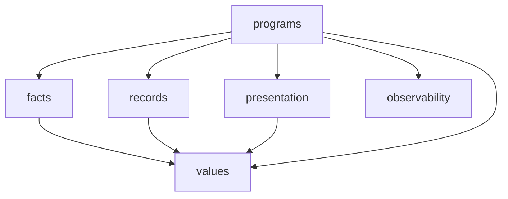

# 구조

이 문서는 `src/tokmo/`의 계층이 각각 무엇을 맡고, 어느 방향으로 서로를 import하는지 설명합니다.

## 계층

| 계층 | 파일 수 | 역할 |
|---|---|---|
| `values` | 86 | 순수 계산과 타입 계약입니다. 외부 I/O가 없고, 다른 계층을 import하지 않습니다 |
| `facts` | 62 | 외부 API 어댑터입니다(토스, KIS, OpenDART, SEC, 뉴스 소스, 텔레그램, FRED 등). 사실을 돌려줄 뿐 저장하지 않습니다 |
| `records` | 80 | SQLite·JSON 저장소입니다. 파일은 0600으로 만들고 심링크는 거부합니다 |
| `programs` | 177 | 흐름입니다(펄스, 캐던스, 뉴스 엔진, 후속 점검, 회전매매, 모의투자, 퀀트). `facts`, `records`, 정책, 표현을 명시적으로 조합합니다 |
| `presentation` | 4 | 값을 사람이 읽을 문자열로 바꿉니다. `format_value()` 하나로 모든 값을 렌더링합니다 |
| `observability` | 2 | 구조화된 JSONL 로거입니다 |
| `runtime` | 2 | 자격증명 env 파일 로더와 시계입니다. 프로세스 환경변수는 읽지 않습니다 |
| `data` | 1 | 수집 시점에 고정한 공식 구성종목 데이터입니다 |

파일 수는 `__init__.py`를 포함하며 2026-10-08 배포판 기준입니다.

## 의존 방향

- `values`는 `values`만 import합니다. `facts`와 `records`가 서로 import하지 않고도 같은 계약으로 검증할 수 있도록, 공유 상수와 타입을 `values`에 둡니다.
- `facts`, `records`, `presentation`은 `values`만 import합니다.
- `programs`만 여러 계층을 조합합니다.

예외는 두 곳이며, 둘 다 함수 안에서 늦게 import합니다.

| 위치 | import 대상 |
|---|---|
| `facts/quant_recurring_membership.py` | `programs.quant_membership` |
| `programs/integrated_pulse.py` | `composition.build_pulse_production_live_deps` |

## 조립 지점

펄스와 캐던스처럼 큰 흐름은 조립 모듈에서 실제 외부 전송(라이브 transport)과 저장소를 묶어 실행합니다.

| 모듈 | 조립하는 것 |
|---|---|
| `composition.py` | 펄스, 캐던스, 토스 연동 전반. `tokmo-live`, `tokmo-cadence` 명령의 진입점입니다 |
| `kis_composition.py` | 한국투자증권 ETF 시세 |
| `fred_composition.py`, `fred_query_composition.py` | FRED 매크로 지표 |
| `opendart_bulk_composition.py` | OpenDART 대량 수집 |

## 실행 진입점

| 경로 | 내용 |
|---|---|
| `tools/run_*.py` | 모듈별 실행 진입점입니다. 스케줄러 래퍼가 부릅니다 |
| `tools/` 나머지 | 설치(`install_*`), 점검(`check_*`, `validate_*`, `verify_*`), 이관(`migrate_*`), 재현(`replay_*`) 도구 |
| `ops/hermes-cron/` | 스케줄러 래퍼입니다. 자기 위치에서 프로젝트 루트를 찾고, 잠금·타임아웃·실패 알림을 처리합니다 |
| `ops/cron/fallback/` | Hermes 보조 도구를 대신하는 최소 구현입니다 |

## 데이터 위치

| 경로 | 내용 |
|---|---|
| `var/data/` | 상태 DB와 설정 JSON(`news_decision.json`, `models.json` 등). 데이터 루트입니다 |
| `var/runtime/` | 잡별 실행 로그와 실행 기록(manifest) |
| `var/state/` | 회전매매 장부와 `live.flag` |
| `.secrets/`, `.env.toss`, `.env.kis` | 자격증명 |
| `~/.hermes/` | 제품 게이트 스크립트, 운영 계약, 모델 라우팅 상태, 쿼터 스냅샷 |
| `watchlists/` | 추적할 종목 목록. git으로 관리합니다 |

## 로그

`observability`의 로거는 INFO 이상을 `events.jsonl`에 기록합니다. DEBUG 기록은 크기가 정해진 메모리 버퍼에만 두었다가, ERROR가 나면 `incident.jsonl`로, 원인 분석을 요청하면 `rca.jsonl`로 내보냅니다. 기록할 수 있는 필드가 정해져 있어서 URL, 요청 본문, 비밀 값이 임의 필드로 로그에 들어가지 않습니다.
